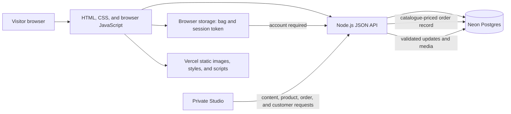

# QUIET BATTLES™

A story-led clothing storefront for the QUIET BATTLES brief. The site connects The Archive to Series, five Chapter Chambers, eight related products, customer accounts, an order history, and a private content Studio.

- **Website:** [Open the site](https://quiet-battles-demo.vercel.app)
- **Source:** [GitHub repository](https://github.com/anudeep2710/quiet-battles)

All product details, prices, and stories are illustrative. Checkout requires an account, but its QR is a non-payable test image: no payment is collected, verified, or transferred.

## Explore

- Homepage: /
- The Archive: /archive
- Series 01 — THE GENTLE ARMOR™: /series/the-gentle-armor
- Chapter 01: /chapter/the-first-quiet
- Product: /product/soft-armor-hoodie
- Product catalogue: /artifacts
- Sign in: /login
- Create an account: /signup
- Private order history: /account
- Studio: /admin

The purchase path is Browse → Add to bag → Checkout → Sign in or create an account → Delivery details → Order review → Test QR → Order confirmation. Guest orders are rejected by the API. The selected bag remains available while the visitor signs in.

## Technology

| Area | Choice |
| --- | --- |
| Frontend | Semantic HTML, responsive CSS, browser JavaScript |
| API | Node.js HTTP handler, shared by local server and Vercel Function |
| Database | Neon Postgres through @neondatabase/serverless |
| Hosting | Vercel; source hosted in GitHub |
| Content management | Custom Studio backed by the same API and database |
| Images | Local WebP editorial images, Unsplash photography, original garment SVGs |
| Fonts | Barlow Condensed, DM Sans, IBM Plex Mono from Google Fonts |

The frontend has no framework or component library. The CMS is built for this project; no CMS plugin or site template is used.

## Architecture

Locally, server.js serves the public files and the API. On Vercel, public/ contains static assets and api/index.js exposes the same request handler. db.js contains the Neon queries and schema setup; data/content.json supplies initial content.

## Run locally

Requirements: Node.js 24.15 or newer, npm, and a Neon Postgres database branch reserved for this project.

1. Install dependencies with npm install.
2. Copy .env.example to .env.local and set DATABASE_URL and QB_ADMIN_KEY. Use a private key with at least 16 characters.
3. Run npm run db:init to create or migrate the schema and seed an empty database.
4. Run npm run dev and open http://127.0.0.1:4173.

Keep .env.local, .studio-key, and all database credentials out of Git. The deployment Studio key is configured as a Vercel environment variable.

The smoke check writes temporary account, order, content, and image records before deleting them. Run it only against a disposable Neon branch. It expects the local server on port 4174 and a .studio-key file containing the same key as QB_ADMIN_KEY. In PowerShell, start the server with $env:PORT = "4174"; npm run dev, then run npm run test:smoke in another terminal.

## Content Studio

Open /admin and enter the private Studio key. The Studio can edit homepage copy; add, edit, and remove Series, Chapters, and products; upload images; and review customer and order records. Uploaded PNG, JPEG, and WebP files are limited to 2 MB and stored in Neon. Order status can be updated and records can be removed. Chapters and products must keep valid links to one another.

The current Studio key is a shared credential. It is suitable for this assessment build, but a real team should use named staff accounts, roles, and an audit log.

## Data model

| Table | Purpose |
| --- | --- |
| site_settings | Brand and homepage content |
| series | Ordered Series records |
| chapters | Chapter story and Series/product links |
| products | Product details, prices, sizes, and imagery |
| media_assets | Uploaded image bytes |
| customers | Customer profile and scrypt-derived password hash |
| customer_sessions | Hashed, expiring customer session token |
| admin_sessions | Hashed, expiring Studio session token |
| orders | Customer-linked delivery, item, price, and status snapshots |

The app validates content links before saving. The order API checks the signed-in customer, validates product and size selections, recalculates prices from the catalogue, and stores an order snapshot. It does not handle real payment details.

See [docs/database-schema.md](docs/database-schema.md) for fields and relationships.

## API overview

| Method and route | Purpose |
| --- | --- |
| GET /api/health | Check API and database connectivity |
| GET /api/content | Read published content |
| GET /api/media/:id | Read an uploaded image |
| POST /api/auth/signup | Create a customer account |
| POST /api/auth/login | Sign in |
| GET /api/auth/me | Read the current account and its orders |
| POST /api/auth/logout | Revoke a customer session |
| POST /api/orders | Validate and record an account-linked order |
| POST /api/admin/login | Start a Studio session |
| PUT /api/admin/content | Save validated content |
| POST /api/admin/upload | Store an image |
| GET /api/admin/orders | List orders in Studio |
| PATCH /api/admin/orders/:id | Update fulfilment status |
| DELETE /api/admin/orders/:id | Remove an order |
| GET /api/admin/customers | List customer accounts |
| DELETE /api/admin/customers/:id | Remove a customer account |

## Submission files

- [Submission overview](SUBMISSION.md)
- [Technical approach and estimate](TECHNICAL_APPROACH.md)
- [Product readiness review](docs/READINESS_REVIEW.md)
- [Database schema](docs/database-schema.md)
- [Screenshots](docs/screenshots/README.md)

## Scope and next steps

This build is for technical assessment, not public commerce. Use sample information only. Email verification, password recovery, generic account-registration responses, effective request throttling, production privacy and retention controls, named Studio users, stock management, shipping and tax calculation, returns, transactional email, and payment-provider verification are not implemented. Before accepting real customer accounts, implement and review the account and privacy controls. Before launching commerce, add inventory, shipping, tax, return, and payment-provider integrations.

The site uses direct paths for its pages, backed by a single-page-app fallback. Page content and titles render in the browser; a production release should add server-side or static rendering, route-specific social metadata, a sitemap, optimized image derivatives, and monitoring.

Five editorial concepts were generated with OpenAI image generation; additional photography is sourced from Unsplash; the garment illustrations are local SVGs. Google Fonts serves the typefaces. OpenAI Codex assisted with implementation, documentation, and code review. Playwright was used for browser review and screenshot capture.
