# QUIET BATTLES™

A story-led streetwear storefront built around one path: **The Archive → Series → Chapter → Artifact → Acquisition.** This repository contains the website source, a custom content Studio, a Neon Postgres API, Playwright screenshots, and a short website walkthrough.

## Review the website

- **Deployed preview:** [quiet-battles-demo.vercel.app](https://quiet-battles-demo.vercel.app) — the Vercel Production alias is connected to this repository's `main` branch.
- **Source:** [GitHub repository](https://github.com/anudeep2710/quiet-battles)
- **Walkthrough video:** [Watch or download the MP4](docs/walkthrough/quiet-battles-walkthrough.mp4) · [Google Drive copy](https://drive.google.com/file/d/1mENUGDQX0RGVkf-2AYvi_thbVM8cEDD1/view?usp=drivesdk) *(anyone with the link can view; no sign-in required)*
- **Code and product status:** [Readiness review](docs/READINESS_REVIEW.md)

[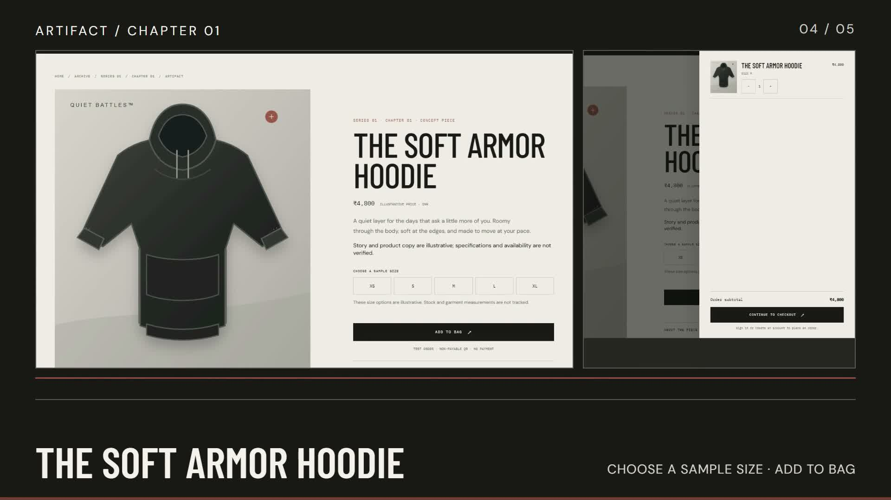](https://drive.google.com/file/d/1mENUGDQX0RGVkf-2AYvi_thbVM8cEDD1/view?usp=drivesdk)

The screenshots and video below were captured from local source with sample content in `data/content.json` through a temporary read-only preview. That preview blocked API routes that could write data; capture created no customer account, Studio owner, or order. The live Vercel Production deployment was checked against GitHub `main`; its health and content endpoints return the expected Neon-backed responses. The Studio image shows the one-time first-access form; its sign-in switch has since received a small styling update.

**Payment notice:** Checkout requires a customer account. Its QR image is illustrative and cannot accept or verify a payment. Orders in this build are workflow records only; no money moves.

## How to use the customer site

1. Start at `/` and choose **Enter the Archive** or **The Archive** in the top navigation.
2. Open **Series 01 — THE GENTLE ARMOR™**. It contains five Chapter stories.
3. Open a Chapter such as **The First Quiet**, read the story, then follow its linked Artifact.
4. On a product page, choose a sample size and select **Add to bag**. The bag drawer shows the item and subtotal; the bag is retained in that browser.
5. Select **Continue to checkout**. The site sends visitors to account access. Create an account or sign in; guest orders are not accepted. The bag remains available while signing in.
6. Enter delivery details, review the order, and continue to the **non-payable test QR**. Confirming records a test order; it does not process payment.
7. Open **Account** to view private order history, search orders and products, see recommendations, or sign out.
8. Use **Artifacts** to browse the catalogue. Category filters and sorting help narrow the eight sample products.

### Direct pages

| Page | Path |
| --- | --- |
| Homepage | `/` |
| The Archive | `/archive` |
| Series 01 — THE GENTLE ARMOR™ | `/series/the-gentle-armor` |
| Chapter 01 — The First Quiet | `/chapter/the-first-quiet` |
| The Soft Armor Hoodie | `/product/soft-armor-hoodie` |
| Product catalogue | `/artifacts` |
| Sign in | `/login` |
| Create an account | `/signup` |
| Customer profile and order history | `/account` |
| Private content Studio | `/admin` |

## How to use the Studio

The Studio is a private content-management area at `/admin`.

1. On first access, create the one-time owner account using an email, password, password confirmation, and the private Studio key configured on the server as `QB_ADMIN_KEY`. The first-access screen also has an **Already have an account? Sign in** option.
2. After setup, `/admin` opens the sign-in form on later visits. Sign in with the owner email, password, and Studio key. The one-time owner account cannot be created again after setup.
3. Use the Studio tabs to edit homepage copy, Series, Chapters, and products. Chapter-to-product links are checked before saving. Only a signed-in Studio session can save content or upload images.
4. **Add product** creates an unsaved draft. Complete every required field before saving: name, type, URL slug, category, positive INR price, at least one unique size, chapter link, description, image, and one or more detail/care lines. The back/detail image is optional. Incomplete drafts are rejected in the form and again by the server.
5. Upload PNG, JPEG, or WebP images up to 2 MB. The Studio stores them in Neon for this assessment build.
6. Review customer and test-order records. Sign out when finished.

The first-use Studio screenshot below shows the one-time owner form. The screenshot capture did not create an owner account or save Studio content. The live Neon-backed content API returns one Series, five Chapters, and eight products; the owner account has since been created. Keep the Studio key and password out of GitHub, screenshots, and the public walkthrough.

## Run locally

Requirements: Node.js 24.15 or newer, npm, and a Neon branch reserved for this project.

```powershell
npm install
Copy-Item .env.example .env.local
```

Set `DATABASE_URL` to the project branch and set `QB_ADMIN_KEY` to a private key at least 16 characters long in `.env.local`. Keep `.env.local` and `.studio-key` out of Git. Do not point schema setup at a production database.

```powershell
npm run db:init
npm run dev
```

Open [http://127.0.0.1:4173](http://127.0.0.1:4173). `npm run db:init` creates or migrates the schema and seeds an empty database. It also updates legacy test-QR order states, so run it only against a disposable Neon branch or after reviewing and backing up the target database. The migration adds shared authentication throttling, checkout idempotency and recovery, and versioned Studio content saves.

On an empty database, visit `/admin` and complete one-time owner setup. Customer sign-up and checkout require the updated database schema. The connected Neon main branch was migrated on 9 November 2026; the live health and content APIs have been verified.

### Checks

```powershell
npm run test:unit
npm run test:admin-auth
```

`npm run test:smoke` writes temporary customer, order, content, and image records. Run it only against a disposable Neon branch. Set `QB_ADMIN_TEST_EMAIL` and `QB_ADMIN_TEST_PASSWORD` in ignored `.env.local`; never set them in Vercel. The smoke script expects the app on port 4174:

```powershell
$env:PORT = '4174'
npm run dev
# In another terminal:
npm run test:smoke
```

## Screenshots

These Playwright captures show the current source UI with sample content. Click any image to open it at full size.

### Story and product journey

| Homepage | The Archive |
| --- | --- |
| <a href="docs/screenshots/submission/01-home-desktop.jpg">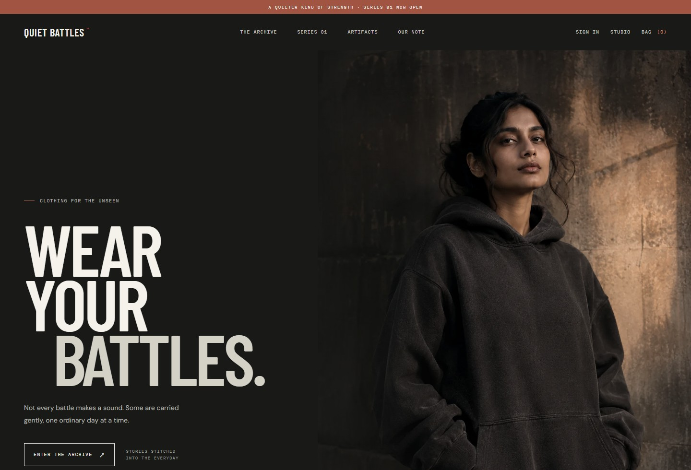</a> | <a href="docs/screenshots/submission/02-archive-desktop.jpg">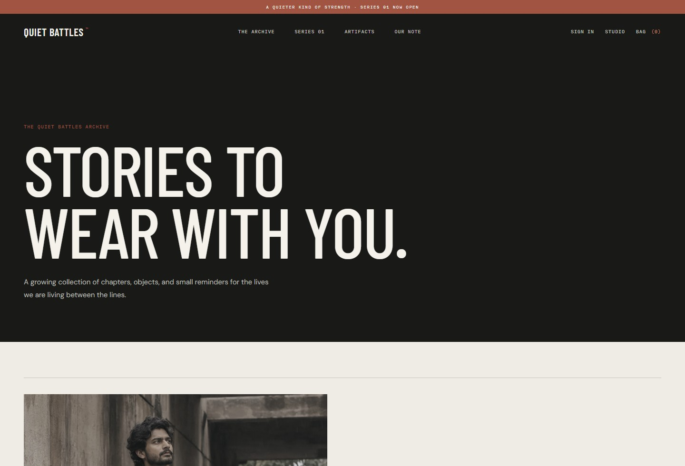</a> |
| Series 01 | Chapter 01 |
| <a href="docs/screenshots/submission/03-series-desktop.jpg">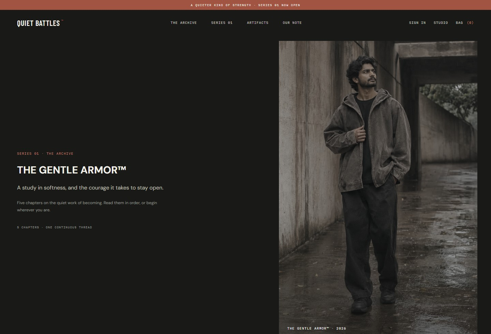</a> | <a href="docs/screenshots/submission/04-chapter-desktop.jpg">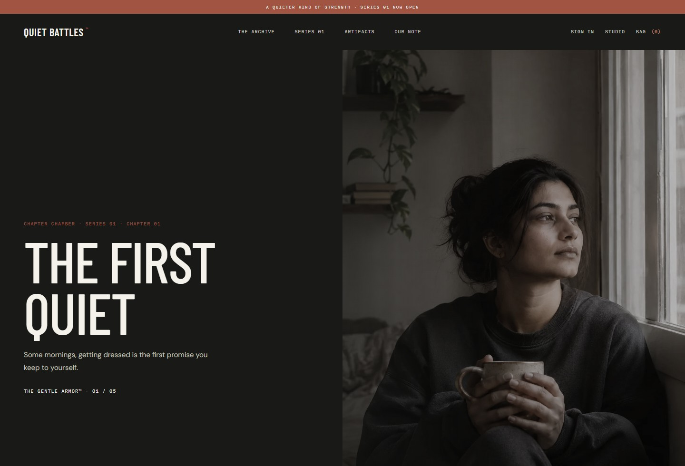</a> |
| Product | Bag |
| <a href="docs/screenshots/submission/05-product-desktop.jpg">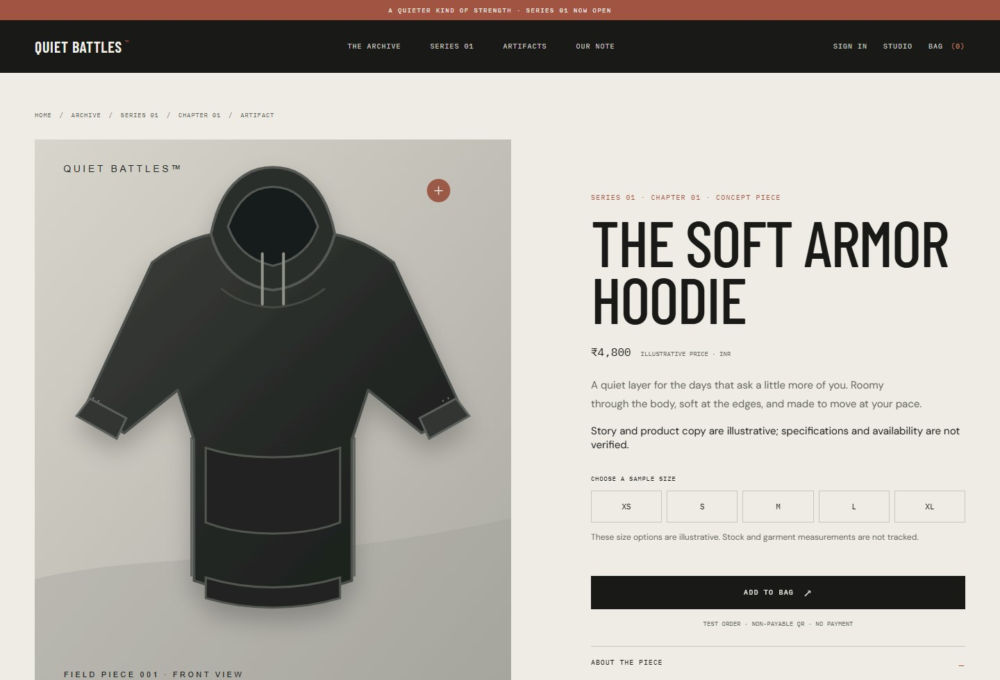</a> | <a href="docs/screenshots/submission/11-bag-desktop.jpg">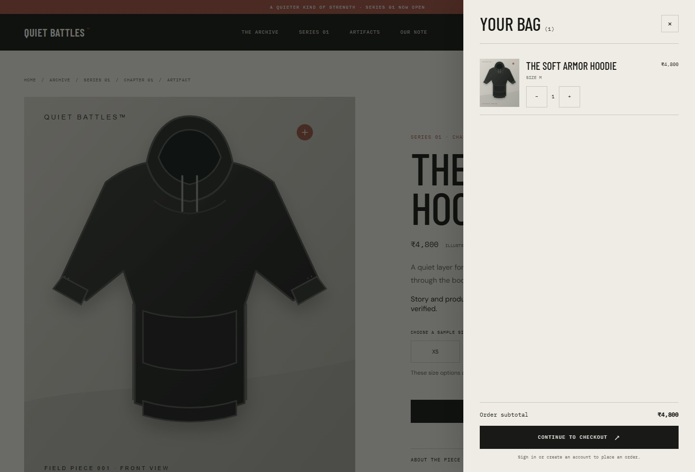</a> |

### Accounts, catalogue, and Studio

| Catalogue | Account-required checkout |
| --- | --- |
| <a href="docs/screenshots/submission/06-catalogue-desktop.jpg">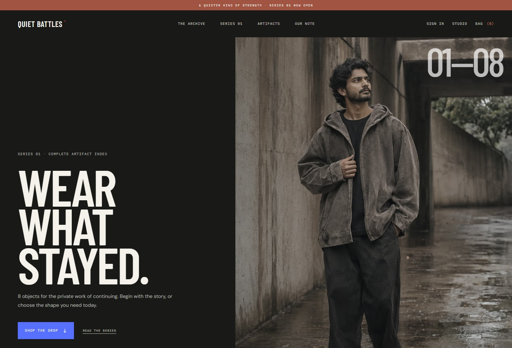</a> | <a href="docs/screenshots/submission/12-checkout-account-gate-desktop.jpg">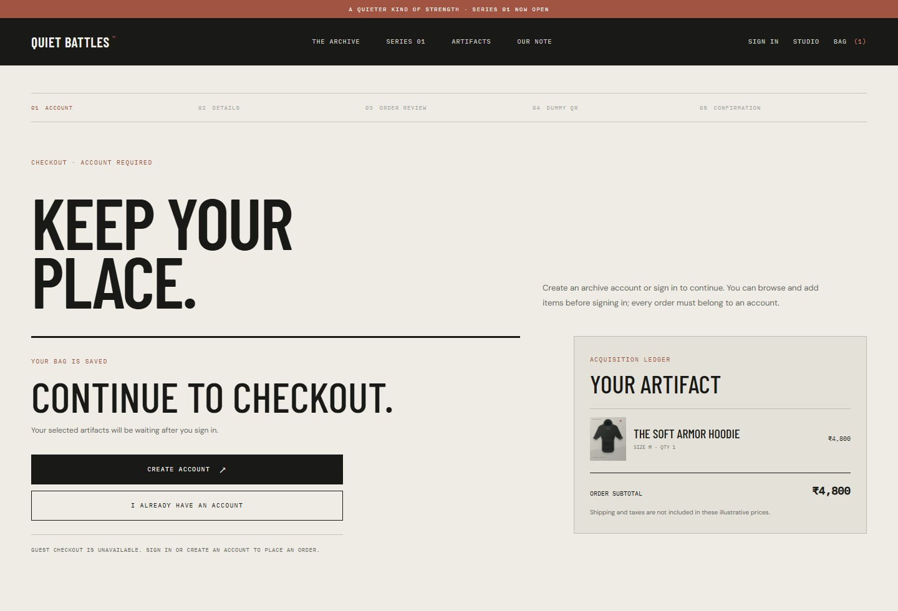</a> |
| Sign in | Create an account |
| <a href="docs/screenshots/submission/07-signin-desktop.jpg">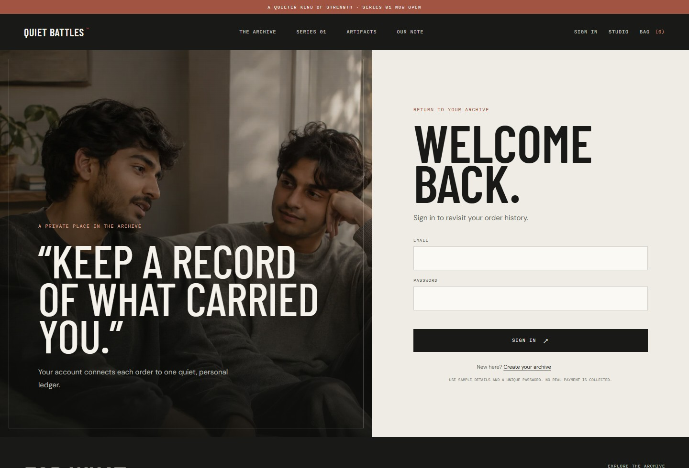</a> | <a href="docs/screenshots/submission/08-signup-desktop.jpg">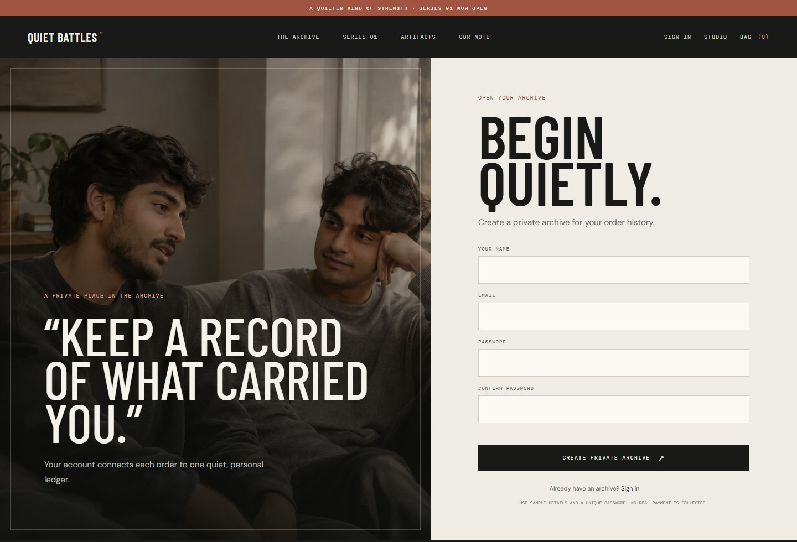</a> |
| Studio first access | Mobile account gate |
| <a href="docs/screenshots/submission/09-studio-setup-desktop.jpg">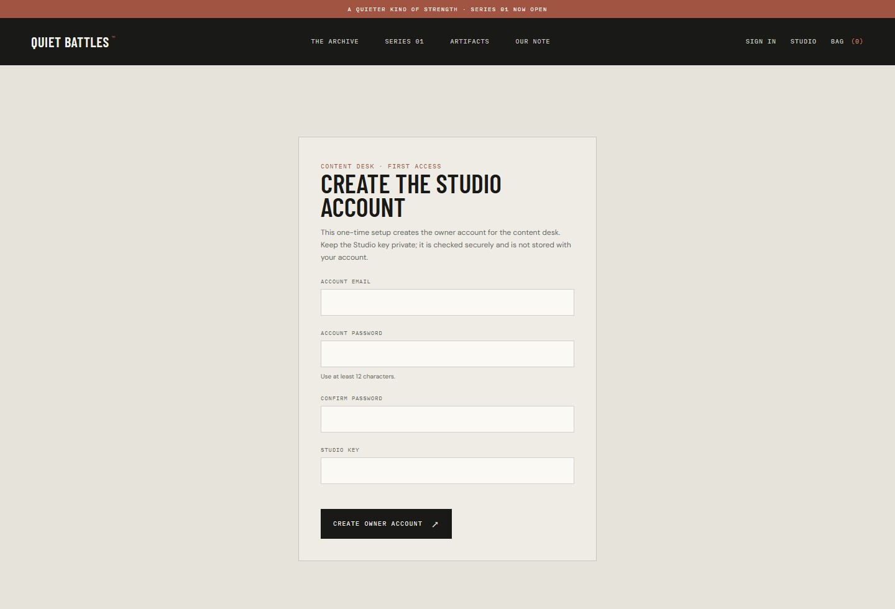</a> | <a href="docs/screenshots/submission/15-checkout-account-gate-mobile.jpg">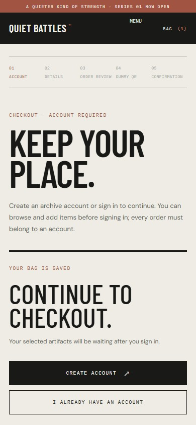</a> |

### Mobile homepage and full homepage

<a href="docs/screenshots/submission/13-home-mobile.jpg">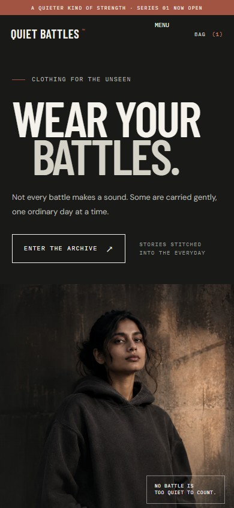</a>

<details>
<summary>Full desktop homepage</summary>

<a href="docs/screenshots/submission/10-home-full.jpg">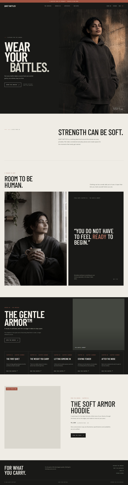</a>

</details>

See [the screenshot index](docs/screenshots/README.md) for capture details and earlier deployed screenshots.

## Technology and architecture

| Area | Technology | Role |
| --- | --- | --- |
| Frontend | Semantic HTML, CSS, browser JavaScript | Responsive pages, navigation, bag, account and Studio interfaces |
| API | Node.js | Shared JSON request handler for local development and Vercel Functions |
| Database | Neon Postgres via `@neondatabase/serverless` | Content, products, media, customer accounts, sessions, orders, and auth limits |
| Hosting | Vercel | Static assets and serverless API |
| Source control | GitHub | Application source and handoff |
| CMS | Custom Studio | Manage homepage, Series, Chapters, products, images, customers, and test orders |

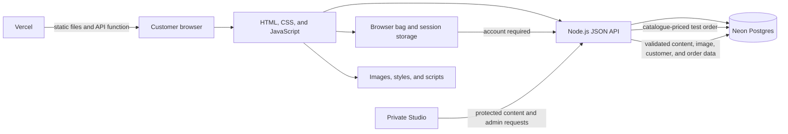

`server.js` serves local pages and the API. `api/index.js` exposes the shared handler on Vercel. `db.js` contains Neon queries and schema setup. `data/content.json` provides initial content. The custom Studio uses the same API and validation path as the public site.

### Data model

The database contains `site_settings`, `series`, `chapters`, `products`, `media_assets`, `customers`, `customer_sessions`, `admin_accounts`, `admin_sessions`, `orders`, and `auth_rate_limits`. Chapters reference Series and products; the Studio validates these links before saving. Order records snapshot customer, item, and price details. Demo orders use `demo_recorded` and `not_payable` states; fulfillment is not available.

See [database schema](docs/database-schema.md) and the API overview below.

## API overview

| Method and route | Purpose |
| --- | --- |
| `GET /api/health` | Check API and database connectivity |
| `GET /api/content` | Read published site content |
| `GET /api/media/:id` | Read an uploaded image |
| `POST /api/auth/signup` · `POST /api/auth/login` | Create a customer account or sign in |
| `GET /api/auth/me` · `POST /api/auth/logout` | Read the signed-in profile and orders, or revoke the session |
| `POST /api/orders` | Revalidate and record an account-linked, non-payable test order |
| `GET /api/orders/attempt/:key` | Recover a test order after a retry or refresh |
| `GET /api/admin/setup-status` · `POST /api/admin/setup` | Check and complete one-time Studio owner setup |
| `POST /api/admin/login` · `GET /api/admin/session` | Sign in to or validate a Studio session |
| `PUT /api/admin/content` · `POST /api/admin/upload` | Save validated content and upload an image |
| `GET /api/admin/orders` · `DELETE /api/admin/orders/:id` | Review or remove a test order |
| `GET /api/admin/customers` · `DELETE /api/admin/customers/:id` | Review or remove a customer account |

## What is and is not implemented

The assessment build demonstrates browsing, catalogue filters and sorting, account-area order/product search, account creation and sign-in, private order history, account-required checkout, non-payable QR confirmation, and content-management screens. Product names, garment details, stories, sizes, prices, stock, and availability are illustrative and require brand approval. Inventory is not tracked.

This is ready to present as an assessment prototype, not as a live commerce service. The deployed Vercel source was verified against GitHub `main`, and the live Neon health/content reads returned 200 with one Series, five Chapters, and eight products. Live customer signup, Studio content saves, and order creation have not been exercised. Email verification, password recovery, secure HttpOnly sessions, customer-data retention rules, named Studio roles, inventory reservation, shipping and tax calculation, returns, transactional email, real payment-provider verification, production SEO rendering, and performance monitoring remain outside this assessment build. Do not collect real customer data or take payment through it.

## Submission and tool disclosure

- The screenshots were captured with the Playwright CLI from current local source using sample JSON content.
- The walkthrough was composed with the Brag workflow and HyperFrames; FFmpeg generated its poster and final MP4. Its soundtrack is locally generated ambient audio with short Kenney CC0 sound effects.
- Five editorial concepts were generated with OpenAI image generation; additional photography is from Unsplash; garment illustrations are original SVGs. Fonts are served by Google Fonts.
- No website template, frontend framework, CMS plugin, or paid UI plugin was used. OpenAI Codex assisted with implementation and documentation.
- The video and stills are in `docs/walkthrough/` and `docs/screenshots/submission/`; this repo contains the source code and database schema.

## Indicative full-project estimate

These ranges assume approved brand copy, product data, size charts, photography rights, policies, and shipping/payment-provider requirements.

| Scope | Time | Indicative fee |
| --- | --- | --- |
| Editorial website and CMS: up to 3 Series, 15 Chapters, 10 products, staff roles, media storage, responsive QA, accessibility and SEO basics, deployment, handover | 6–8 weeks | ₹1,80,000–₹2,60,000 |
| Commerce completion: checkout, order records, stock hooks, shipping/tax rules, payment integration, launch QA | 2–4 additional weeks | ₹90,000–₹1,50,000 |
| Combined | 8–12 weeks | ₹2,70,000–₹4,10,000 |

This is a scoping estimate, not a fixed quote. It excludes hosting, database and media usage, payment-provider fees, content production, taxes, and ongoing maintenance. Agree a fixed fee after requirements and acceptance criteria are confirmed.

## Supporting documents

- [Product and technical readiness review](docs/READINESS_REVIEW.md)
- [Database schema](docs/database-schema.md)
- [Screenshot index](docs/screenshots/README.md)
- [Walkthrough poster and video](docs/walkthrough/quiet-battles-poster.jpg) · [MP4](docs/walkthrough/quiet-battles-walkthrough.mp4)
