# QUIET BATTLES™

A story-led clothing storefront for the QUIET BATTLES brief. The site connects The Archive to Series, five Chapter Chambers, eight related products, customer accounts, an order history, and a private content Studio.

- **Website:** [Open the site](https://quiet-battles-demo.vercel.app)
- **Source:** [GitHub repository](https://github.com/anudeep2710/quiet-battles)

All product details, prices, and stories are illustrative. Checkout requires an account, but its QR is a non-payable test image: no payment is collected, verified, or transferred.

## Watch the walkthrough

[Play or download the short walkthrough](docs/walkthrough/quiet-battles-walkthrough.mp4) · [View current desktop and mobile screenshots](docs/screenshots/README.md)

## Review guide

1. Start at the [homepage](https://quiet-battles-demo.vercel.app/) and enter [The Archive](https://quiet-battles-demo.vercel.app/archive).
2. Open [Series 01](https://quiet-battles-demo.vercel.app/series/the-gentle-armor), choose a Chapter such as [The First Quiet](https://quiet-battles-demo.vercel.app/chapter/the-first-quiet), and follow its link to [The Soft Armor Hoodie](https://quiet-battles-demo.vercel.app/product/soft-armor-hoodie).
3. Choose a size, add the hoodie to the bag, and continue to checkout. [Sign in](https://quiet-battles-demo.vercel.app/login) or [create an account](https://quiet-battles-demo.vercel.app/signup) to place a test order. The QR cannot accept payment.
4. Browse the [full catalogue](https://quiet-battles-demo.vercel.app/artifacts). The private [Studio](https://quiet-battles-demo.vercel.app/admin) manages site content and orders; its sign-in credentials are shared separately with reviewers.

### Direct page paths

- Homepage: /
- The Archive: /archive
- Series 01 — THE GENTLE ARMOR™: /series/the-gentle-armor
- Chapter 01: /chapter/the-first-quiet
- Product: /product/soft-armor-hoodie
- Product catalogue: /artifacts
- Sign in: /login
- Create an account: /signup
- Private order history: /account
- Studio: /admin

The purchase path is Browse → Add to bag → Checkout → Sign in or create an account → Delivery details → Order review → Test QR → Order confirmation. Guest orders are rejected by the API. The selected bag remains available while the visitor signs in.

## Screenshots

Click an image to open it at full size. The [screenshot index](docs/screenshots/README.md) also includes the route and review notes for each capture.

### Story and shopping

| Homepage | The Archive |
| --- | --- |
| <a href="docs/screenshots/current/01-home-desktop.jpg">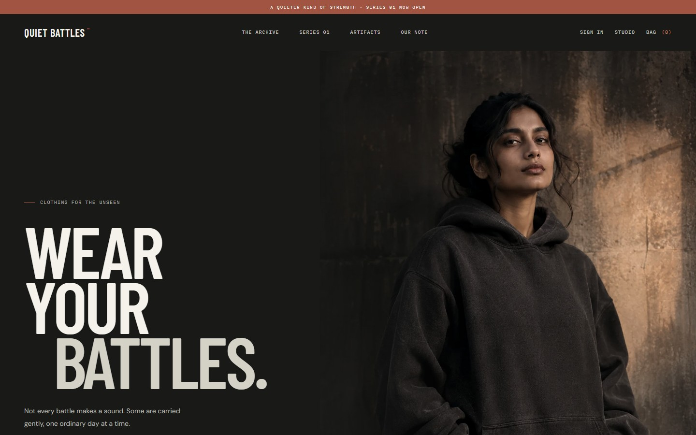</a> | <a href="docs/screenshots/current/02-archive-desktop.jpg">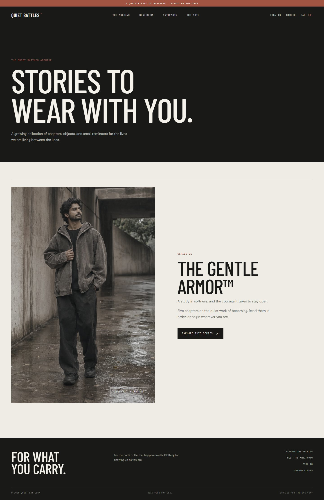</a> |
| Series 01 | Chapter 01 |
| <a href="docs/screenshots/current/03-series-desktop.jpg">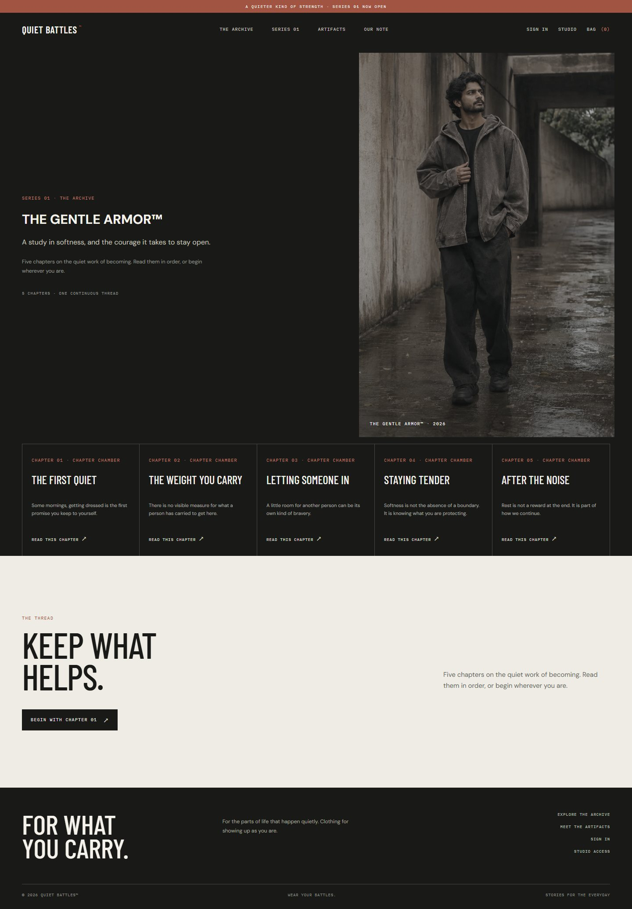</a> | <a href="docs/screenshots/current/04-chapter-desktop.jpg">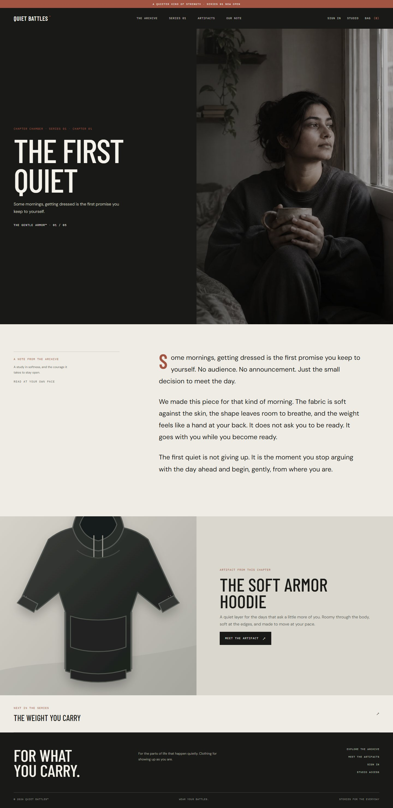</a> |
| Artifact | Catalogue |
| <a href="docs/screenshots/current/05-product-desktop.jpg">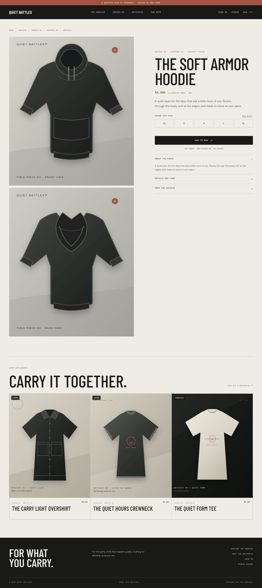</a> | <a href="docs/screenshots/current/06-catalogue-desktop.jpg">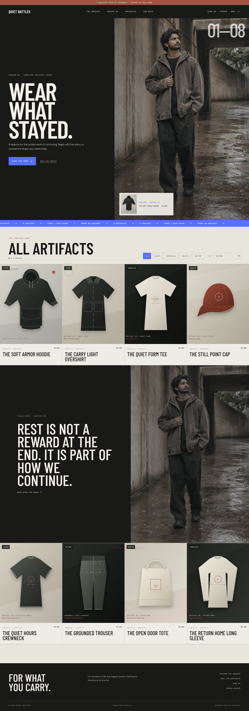</a> |

View the full homepage capture

<a href="docs/screenshots/current/01-home-full.jpg">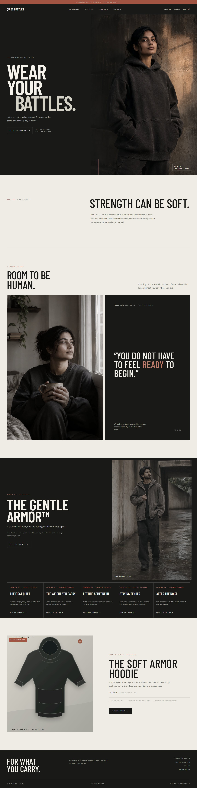</a>

### Accounts and Studio

| Sign in | Create account | Studio access |
| --- | --- | --- |
| <a href="docs/screenshots/current/07-signin-desktop.jpg">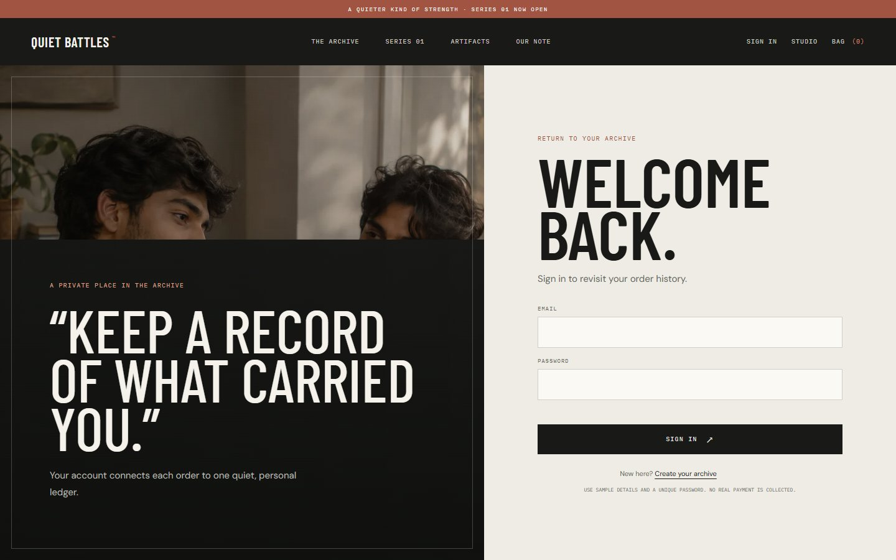</a> | <a href="docs/screenshots/current/08-signup-desktop.jpg">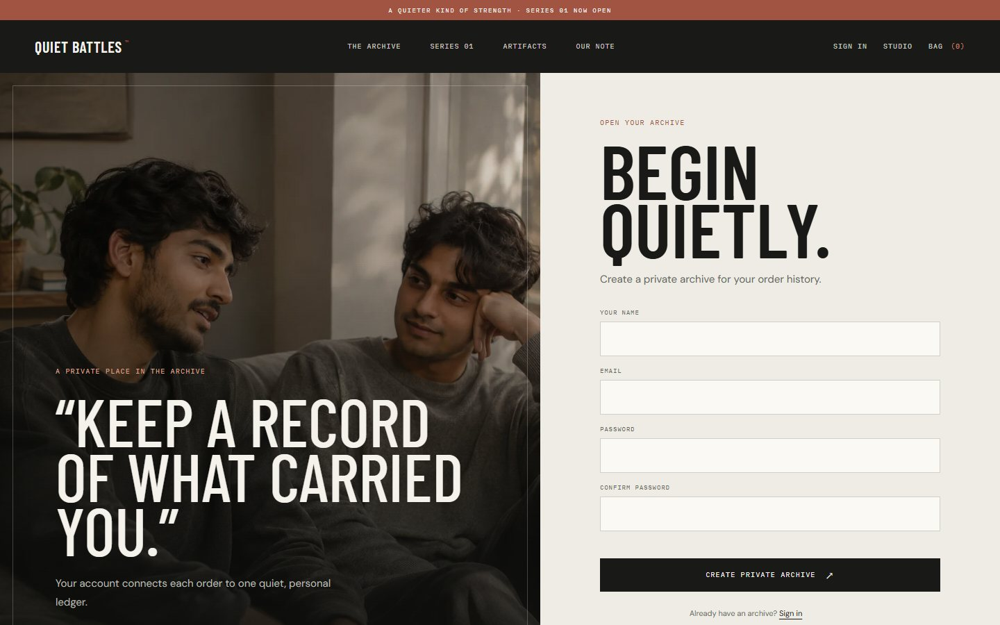</a> | <a href="docs/screenshots/current/09-studio-access-desktop.jpg">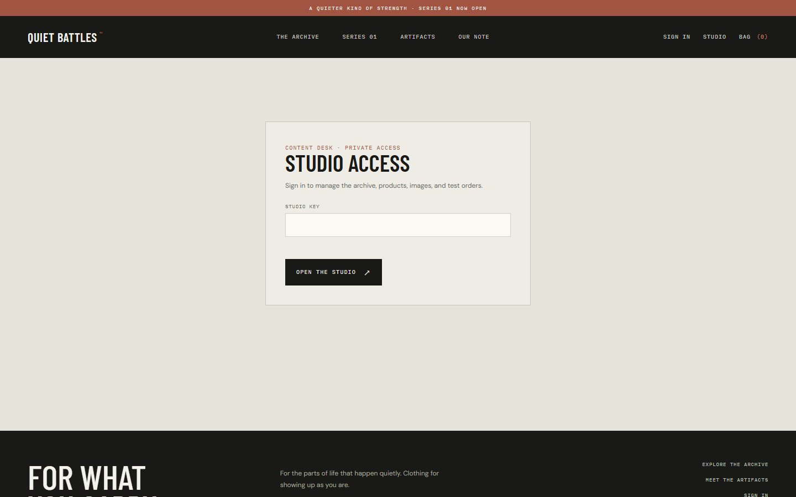</a> |

### Mobile

| Homepage | Product |
| --- | --- |
| <a href="docs/screenshots/current/10-home-mobile.jpg">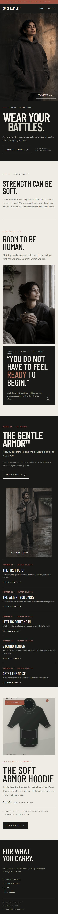</a> | <a href="docs/screenshots/current/11-product-mobile.jpg">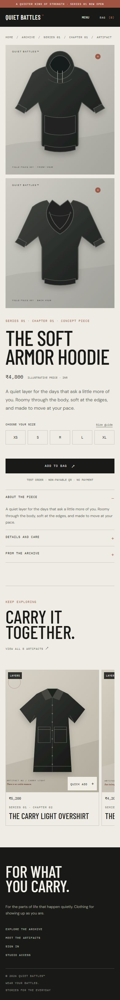</a> |
| Catalogue | Checkout account gate |
| <a href="docs/screenshots/current/12-catalogue-mobile.jpg">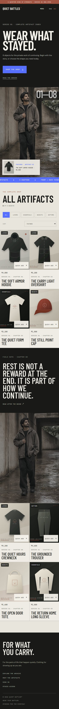</a> | <a href="docs/screenshots/current/13-checkout-account-gate-mobile.jpg">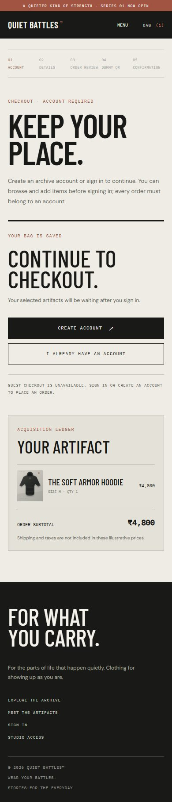</a> |

## Technology

| Area | Choice |
| --- | --- |
| Frontend | Semantic HTML, responsive CSS, browser JavaScript |
| API | Node.js HTTP handler, shared by local server and Vercel Function |
| Database | Neon Postgres through @neondatabase/serverless |
| Hosting | Vercel; source hosted in GitHub |
| Content management | Custom Studio backed by the same API and database |
| Images | Local WebP editorial images, Unsplash photography, original garment SVGs |
| Fonts | Barlow Condensed, DM Sans, IBM Plex Mono from Google Fonts |
| Walkthrough media | Playwright CLI captures, Hyperframes composition, FFmpeg poster and encoding |

The frontend has no framework or component library. The CMS is built for this project; no CMS plugin or site template is used.

## Architecture

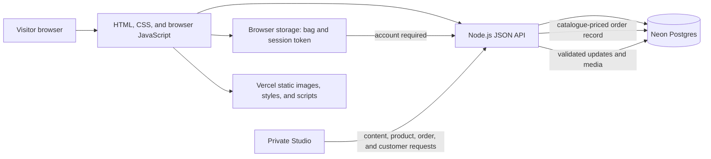

Locally, server.js serves the public files and the API. On Vercel, public/ contains static assets and api/index.js exposes the same request handler. db.js contains the Neon queries and schema setup; data/content.json supplies initial content.

## Run locally

Requirements: Node.js 24.15 or newer, npm, and a Neon Postgres database branch reserved for this project.

1. Install dependencies with npm install.
2. Copy .env.example to .env.local and set DATABASE_URL and QB_ADMIN_KEY. Use a private Studio key with at least 16 characters.
3. Run npm run db:init to create or migrate the schema and seed an empty database.
4. Run npm run dev and open http://127.0.0.1:4173. The first visitor with the Studio key can create the one-time owner account at /admin.

Keep .env.local, .studio-key, and database credentials out of Git. Configure DATABASE_URL and the same private Studio key in Vercel. Changing QB_ADMIN_KEY invalidates existing Studio sessions. The account password is salted and hashed by the server, then stored in Neon; only the account owner can use the login form after initial setup.

The smoke check writes temporary customer, order, content, and image records. Run it only against a disposable Neon branch. Set QB_ADMIN_TEST_EMAIL and QB_ADMIN_TEST_PASSWORD in ignored .env.local; on a fresh branch the test creates this test-only Studio account once. Never set those variables in Vercel. The check expects the local server on port 4174. In PowerShell, start it with `$env:PORT = "4174"; npm run dev`, then run `npm run test:smoke` in another terminal. The isolated `npm run test:admin-auth` check does not use Neon.

## Content Studio

Open /admin. On first use, create the owner account with an email, password, password confirmation, and private Studio key. The key is checked against a server-only secret and is never stored in Neon. Setup is locked after the first account is saved; later visits use the email, password, and key sign-in form. Passwords are scrypt-hashed with a random salt in Neon. The Studio can edit homepage copy; add, edit, and remove Series, Chapters, and products; upload images; and review customer and order records. Uploaded PNG, JPEG, and WebP files are limited to 2 MB and stored in Neon. Order status can be updated and records can be removed. Chapters and products must keep valid links to one another.

The Studio uses one owner credential set. A real team should use named staff accounts, roles, and an audit log.

## Data model

| Table | Purpose |
| --- | --- |
| site_settings | Brand and homepage content |
| series | Ordered Series records |
| chapters | Chapter story and Series/product links |
| products | Product details, prices, sizes, and imagery |
| media_assets | Uploaded image bytes |
| admin_accounts | One-time Studio owner email and salted scrypt password hash |
| customers | Customer profile and scrypt-derived password hash |
| customer_sessions | Hashed, expiring customer session token |
| admin_sessions | Hashed, expiring Studio session token |
| orders | Customer-linked delivery, item, price, and status snapshots |

The app validates content links before saving. The order API checks the signed-in customer, validates product and size selections, recalculates prices from the catalogue, and stores an order snapshot. It does not handle real payment details.

See [docs/database-schema.md](docs/database-schema.md) for fields and relationships.

## API overview

| Method and route | Purpose |
| --- | --- |
| GET /api/health | Check API and database connectivity |
| GET /api/content | Read published content |
| GET /api/media/:id | Read an uploaded image |
| POST /api/auth/signup | Create a customer account |
| POST /api/auth/login | Sign in |
| GET /api/auth/me | Read the current account and its orders |
| POST /api/auth/logout | Revoke a customer session |
| POST /api/orders | Validate and record an account-linked order |
| GET /api/admin/setup-status | Check whether first-time Studio setup is complete |
| POST /api/admin/setup | Create the one-time Studio owner account |
| POST /api/admin/login | Start a Studio session |
| GET /api/admin/session | Validate the current Studio session |
| PUT /api/admin/content | Save validated content |
| POST /api/admin/upload | Store an image |
| GET /api/admin/orders | List orders in Studio |
| PATCH /api/admin/orders/:id | Update fulfilment status |
| DELETE /api/admin/orders/:id | Remove an order |
| GET /api/admin/customers | List customer accounts |
| DELETE /api/admin/customers/:id | Remove a customer account |

## Submission files

- [Submission overview](SUBMISSION.md)
- [Technical approach and estimate](TECHNICAL_APPROACH.md)
- [Product readiness review](docs/READINESS_REVIEW.md)
- [Database schema](docs/database-schema.md)
- [Screenshots](docs/screenshots/README.md)
- [Walkthrough video](docs/walkthrough/quiet-battles-walkthrough.mp4)

## Scope and next steps

This build is for technical assessment, not public commerce. Use sample information only. Customer email verification, password recovery, generic account-registration responses, shared/edge-enforced request throttling, production privacy and retention controls, named Studio users, stock management, shipping and tax calculation, returns, transactional email, and payment-provider verification are not implemented. Studio setup and sign-in use a basic per-instance attempt limit; replace it with shared edge or database-backed throttling before public use. Before accepting real customer accounts, implement and review the account and privacy controls. Before launching commerce, add inventory, shipping, tax, return, and payment-provider integrations.

The site uses direct paths for its pages, backed by a single-page-app fallback. Page content and titles render in the browser; a production release should add server-side or static rendering, route-specific social metadata, a sitemap, optimized image derivatives, and monitoring.

Five editorial concepts were generated with OpenAI image generation; additional photography is sourced from Unsplash; the garment illustrations are local SVGs. Google Fonts serves the typefaces. OpenAI Codex assisted with implementation, documentation, and code review. Playwright CLI captured the current screenshots. The walkthrough was composed with the Brag skill and Hyperframes, with FFmpeg used for the poster and final video.
