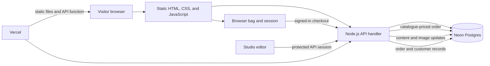

# QUIET BATTLES™ — Technical Approach and Estimate

## Product direction

The experience follows the brand's path: QUIET BATTLES™ → The Archive → Series → Chapters → Chapter Chamber → Artifact → Acquisition.

Each Chapter connects a personal story to a garment. The homepage opens with the brand's central line, “WEAR YOUR BATTLES.” Visitors can explore the Archive and product catalogue without an account. They create an account or sign in before entering delivery details and confirming an order.

The current content includes one Series, five Chapter stories, and eight products. Stories, garment details, photography, and prices are illustrative until approved by the brand.

## Architecture

The same API handler serves local development through server.js and production through api/index.js. db.js contains database access and schema setup. data/content.json seeds the initial site content. The public interface is in public/.

## Technology choices

- **HTML, CSS, and JavaScript** keep the visitor experience direct, lightweight, and easy to maintain.
- **Node.js** validates content, customer sessions, image uploads, product selections, and order totals on the server.
- **Neon Postgres** stores site content, product data, images, customer accounts, sessions, and order records.
- **Vercel** serves static assets and runs the API function. The repository is on GitHub.
- **Custom Studio** keeps content editing in the same data model and validation path as the public site.

The database supports multiple Series. Chapters link to a Series and a product; products link back to a Chapter. Studio validates those relationships before saving content. The schema is described in [docs/database-schema.md](docs/database-schema.md).

## Visitor flow

The Archive leads to Series pages and their Chapter Chambers. Each Chapter has a story, image, and linked garment. The eight-product catalogue supports category filters, sorting, quick size selection, and front/back illustrations. The bag is kept in the browser.

A customer account is required to place an order. Passwords are salted and derived with Node's scrypt. Neon stores the derived password hash and only a hash of each random session token. Sessions expire after seven days. The server validates the customer session and rechecks every product, size, quantity, and current price before recording an account-linked order.

The final checkout step uses a test QR that cannot accept payment. The customer acknowledges that no payment will occur; the order record is a workflow record only. No payment credential, bank connection, UPI address, or payment-provider transaction is created.

## Studio

On first use, the owner creates a single Studio account with an email, password, confirmation, and Studio key. The server checks the key against its environment secret and stores a random-salt scrypt password hash in Neon. The singleton account row makes setup one-time. Later visits require the owner email, password, and key. Sign-in creates a random four-hour token; Neon stores its HMAC hash, keyed with the Studio secret. Studio can manage homepage content, Series, Chapters, products, uploaded images, customer accounts, and order fulfilment status. Images are limited to 2 MB and checked by file signature. Content updates validate slugs and cross-links and are committed in a database transaction.

The shared Studio key is appropriate for this assessment build. Production access should use named staff accounts, roles, recovery controls, and an audit log.

## Performance, accessibility, and search

Static assets are served directly from Vercel. The existing stylesheet includes responsive layouts, visible focus styles, and reduced-motion support. The home page includes a description, Open Graph metadata, a favicon, and image text alternatives. Screenshots show desktop and mobile layouts.

The site uses direct page paths with a single-page-app fallback. Page content and titles render in the browser. A production version should add server-side or static rendering, route-specific social metadata, a sitemap, optimized image variants, and performance monitoring.

## Security and operating limits

The customer account flow lacks email verification, password recovery, account-enumeration protections, and reliable rate limiting. Studio setup and login use a basic per-instance attempt limit; production should use shared edge or database-backed throttling. Privacy notices, retention controls, named Studio identities, and role-based access also need work before public customer data is collected. The build should use sample information only.

A production commerce release also needs inventory reservation, shipping and tax rules, returns, transactional email, payment-provider verification and webhooks, and a media service instead of database-stored image bytes.

## Asset and tool disclosure

The site uses five editorial concepts generated with OpenAI image generation, supplementary Unsplash photography, and original local SVG garment illustrations. Fonts are loaded from Google Fonts. No template, UI framework, CMS plugin, or paid UI plugin was used. OpenAI Codex assisted with implementation, documentation, and code review. Playwright was used for browser review and screenshots.

## Indicative production timeline and quotation

These ranges assume the client provides approved brand assets, final copy, product data, photography rights, size charts, policies, and access to shipping and payment providers.

| Scope | Estimated time | Indicative fee |
| --- | --- | --- |
| Editorial website and CMS: up to three Series, 15 Chapters, 10 products, staff roles, media storage, responsive QA, accessibility and SEO basics, deployment, handover | 6–8 weeks | ₹1,80,000–₹2,60,000 |
| Commerce completion: checkout, order records, stock hooks, shipping/tax rules, payment integration and launch QA | 2–4 additional weeks | ₹90,000–₹1,50,000 |
| Combined estimate | 8–12 weeks | ₹2,70,000–₹4,10,000 |

The estimate excludes hosting, database and media usage, payment-provider fees, content production, taxes, and ongoing maintenance. Confirm a fixed fee after scope and acceptance criteria are agreed.

## Maintenance

The site owner can update content and product records through Studio. Source code is hosted in GitHub, deployments run through Vercel, and structured content is stored in Neon. Before production, replace the shared Studio key, migrate media to object storage, add account and privacy controls, and connect the selected commerce services.
